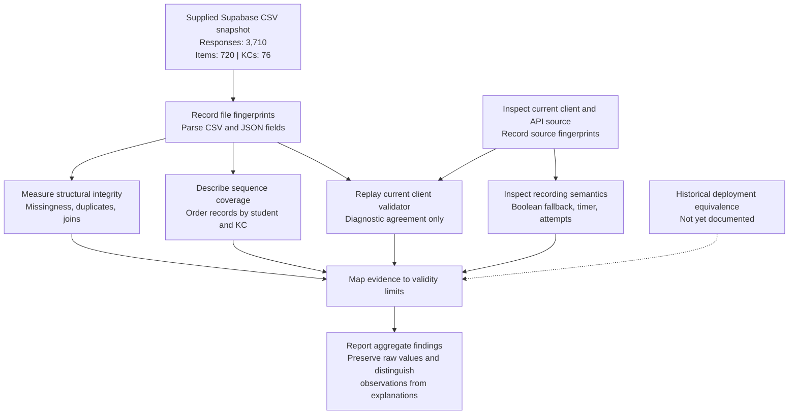
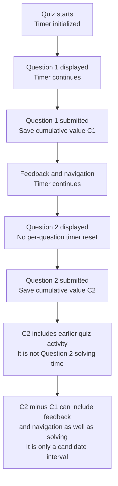

# Mermaid figure sources for the AAIE manuscript

These are schematic diagrams, not plots of estimated effects. Export each Mermaid block separately as a vector PDF, using the filename below, and upload it to the `figures/` folder in Overleaf. Markdown/Mermaid is the editable source; LaTeX includes the exported graphic. Overleaf does not typeset these Mermaid blocks directly.

The `.tex` manuscript keeps a visible placeholder until each named PDF exists. No diagram export or PDF compilation was performed for this revision.

## Figure 1 — Read-only audit workflow

Export filename: `audit-workflow.pdf`

Caption: Read-only audit workflow. Export measurements and current-source diagnostics converge in an evidence-to-validity mapping. Historical deployment equivalence remains an unresolved provenance question.

Interpretation: No cohort exclusion, label imputation, model fitting, or database update is represented. The full export is retained for the audit. File fingerprints identify the local inputs; they do not establish the export execution time or the historical deployed revision.

## Figure 2 — Cumulative timer interpretation

Export filename: `timer-semantics.pdf`

Caption: Schematic interpretation of the current client timer. A later saved value includes earlier quiz activity. Differences between cumulative values can also include feedback and navigation; they are not established measurements of item-solving latency. The diagram represents inspected code behavior, not a verified historical trace.

Interpretation: `C1` and `C2` are symbolic saved values. No fabricated student example or synthetic numerical duration is introduced. Historical use of this timer implementation remains to be verified.

## Export and presentation notes

- Export the diagram only, with a white background and dark text; the manuscript supplies the caption.
- Use a vector PDF and inspect readability at IEEE column width. Simplify labels or use a full-width figure if necessary.
- Keep the distinction between current-source behavior and historical execution when presenting the diagrams.
- Recheck counts against `analysis/audit_results.json` if the underlying snapshot changes.
- If the paper changes to a predictive comparison, revise the diagrams and captions to describe the procedure actually performed.
