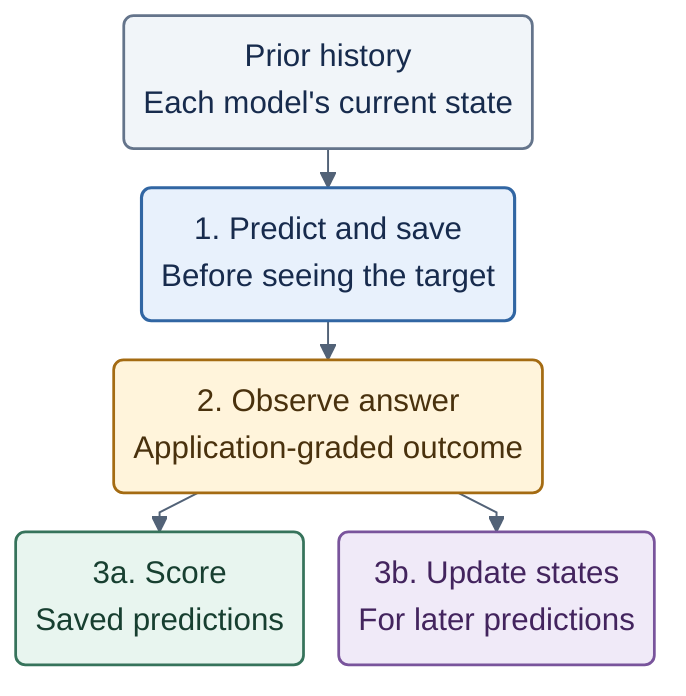
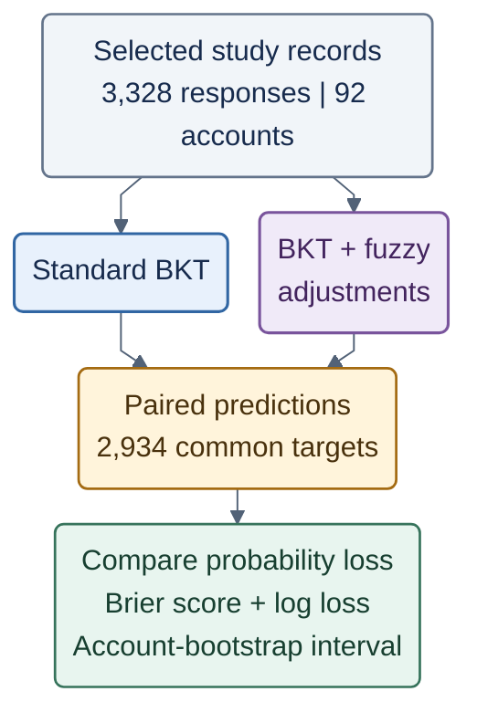

# Mermaid figures for the completed BKT comparison

These compact diagrams summarize the executed protocol. Each uses four rows, short labels and muted colors that remain distinguishable by their text in grayscale. Detailed selection rules and implementation caveats stay in the manuscript rather than inside the figures.

Export each Mermaid block separately as a vector PDF and upload the named file into `figures/` in Overleaf. Crop to the diagram bounds with a small margin. The manuscript includes the export when present and otherwise keeps a visible placeholder. No PDF compilation or diagram rendering was performed for this revision.

## Figure 1 — Prediction before updating

Export as `figures/prediction-order.pdf`.

Caption: Executed prediction order. The target response and its interaction fields are used only after its probability has been produced. Their effect can enter a later prediction.

The two bottom boxes are consequences of observing the answer: scoring uses the saved probabilities, while updating affects later predictions. Neither supplies information to the prediction already saved. The current answer, time and hints are unavailable at prediction time. The current response is available to the source wrapper at update time because the original controller inserted it before updating mastery. Source-fixture tests verified prefix invariance and the inability of a target's own answer, time or hints to alter its preceding prediction.

## Figure 2 — Offline comparison workflow

Export as `figures/comparison-workflow.pdf`.

Caption: Executed offline comparison using common inputs, parameters and targets. Only aggregate results are exported. The design evaluates the pinned algorithm on observed trajectories and does not establish historical online use of that algorithm.

Both branches use the same fixed BKT parameters and prediction-before-update order. The hybrid also receives the unchanged recorded time input. The first observation in each of 394 student-KC sequences updates state only, leaving 2,934 scored targets. The 2,000-replicate paired account bootstrap uses seed 20261018. Pooled AUROC and equal-account probability losses are additional reported summaries; the compact diagram emphasizes the primary probability-loss comparison.

All counts are computed from the frozen exports. The hybrid-minus-BKT Brier difference is +0.00074, with a 95% interval of [-0.00038, +0.00193]. The interval spans zero. AUROC is slightly higher for the hybrid, while both probability losses are higher; do not present the diagram as proof of equivalence or universal ineffectiveness of fuzzy approaches.

## Interpretation and export notes

- The evaluated Express utility is pinned to revision `0c407d0`; the inspected Netlify handlers use a different update. Historical deployment equivalence is unverified.
- The 92 IDs are account clusters; independent participant eligibility and unknown test/demo status remain limitations.
- Practice responses can enter source-defined recent context but do not update either model's mastery and are not scored.
- Current-source session behavior and cumulative time inputs are preserved. The workflow does not represent corrected telemetry or new fuzzy thresholds.
- Export the diagrams only, with a white background and dark readable text. The LaTeX file supplies captions.
- Prefer vector PDF: it keeps text sharp when resized and matches the existing LaTeX filenames. If using PNG, export at least 1,200 pixels wide, crop excess whitespace and upload it under the filename used by your Overleaf figure command.
- Use one IEEE column per figure. Both diagrams have four rows; avoid adding the explanatory paragraphs to the exported image. Inspect the final text at actual column width in Overleaf.
- Blue identifies Bayesian prediction, purple identifies adjustments or state updates, amber identifies observed targets, and green identifies scoring. Labels preserve the meaning when printed in grayscale.
- Numeric provenance is in `analysis/comparison_results.json`; do not insert invented scores or participant details.
